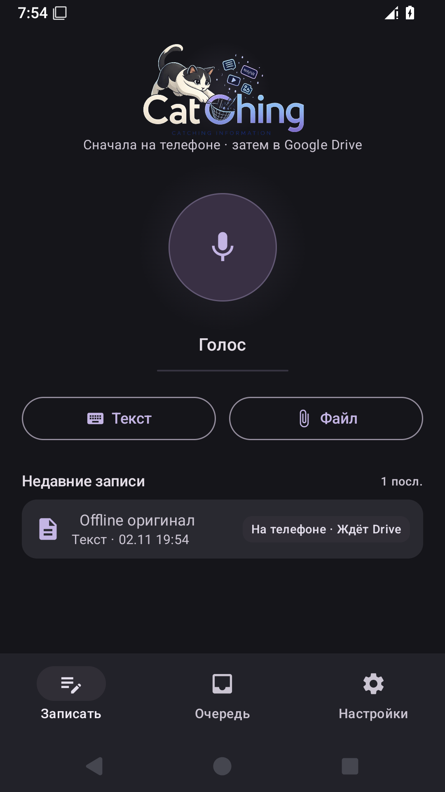
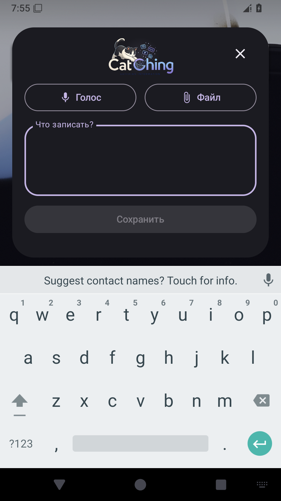
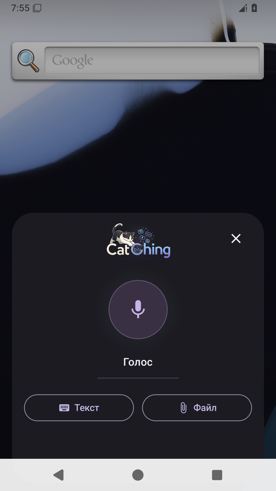
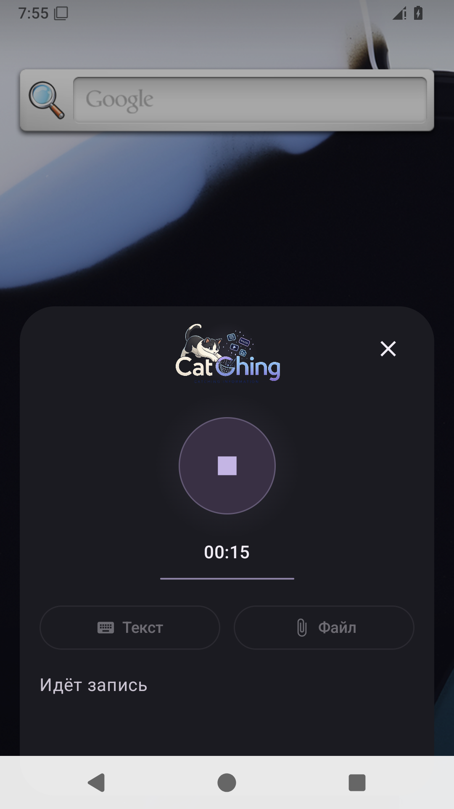

# Catching 0.6.2: OAuth, ассистент и локальные статусы

Доработка по [проверке владельца на настоящем телефоне](https://github.com/dedtsss/dispatcher-android-inbox/issues/7#issuecomment-6585876238). Предыдущая 0.6.1 исправляет миграцию, но не считается принятым UX/Drive-релизом.

## Причины и изменения

`DriveConnectActivity` раньше отбрасывал результат при `resultCode != RESULT_OK` и сохранял сообщение об отмене без чтения SDK-результата. Теперь обработчик всегда вызывает `AuthorizationClient.getAuthorizationResultFromIntent`: результат и `ApiException` разбираются независимо от значения resultCode. Это соответствует [официальному образцу Google](https://developer.android.com/identity/authorization). Чужая ошибка больше не объявляется отменой: отменой считается явный API status 16. Неизвестный ответ показывает, что авторизация не завершена, с переходом к диагностике.

Диагностика доступна в настройках под отдельным действием, сохраняется в DataStore и пишется в `CatchingOAuth`: этап authorize/resolution/drive_about, resultCode, ApiException/statusName/providerMessage, HTTP-код/reason, hasResolution, наличие токена без его значения, подтверждение scope, фактические package и SHA-1 установленного APK. Токены, authorization codes и Intent extras не печатаются; текст провайдера сокращается и очищается от email/длинных непрозрачных значений. HTTP 403 от Drive различается с ошибкой Android OAuth. Успешный статус подключения выставляется только после проверки разрешения, получения токена и успешного `Drive about`.

`forceVoiceStart=true` в assistant entry игнорировал намерение пользователя. Добавлены отдельные сохраняемые настройки:

| При вызове ассистента | Сразу начинать запись | Поведение |
|---|---|---|
| Текст | Значение не применяется; переключатель недоступен | Поле раскрыто, запрошены фокус и клавиатура; запись не начинается |
| Голос | OFF | Круглый микрофон в ожидании |
| Голос | ON | Запись после проверки разрешения микрофона |

Главный экран, плитка и shortcut сохраняют собственный режим и явный голосовой вход. Ассистент использует свои настройки. При раскрытом тексте большой голосовой блок скрыт: поле и сохранение доступны с открытой клавиатурой; действие «Голос» возвращает микрофон.

Оверлей ограничен шириной 400 dp с наружными отступами и скруглённой плавающей карточкой. Прежний фирменный логотип с надписью используется без перегенерации, заметно меньшего размера; микрофон/остановка круглый, таймер отдельный. Волна — одна спокойная линия, высота которой зависит от измеренной амплитуды, без случайного эквалайзера. Ореол/яркость мягко реагируют на уровень голоса. На главном экране логотип уменьшен до 156 dp, сохранены текст, файл, голос, последние записи и навигация.

`currentAmplitude()` опрашивается раз в 100 мс в Job, запущенном только после успешного старта MediaRecorder. Используются логарифмическая нормализация, сглаживание и анимация 180 мс. Job отменяется при остановке, ошибке и очистке ViewModel; во время ожидания опрос отсутствует. Таймер основан на монотонных часах.

## Offline-first и повтор

Общий помощник отображения используется главным экраном и очередью. До подключения аккаунта все сохранённые несинхронизированные записи показывают «На телефоне · Ждёт Drive» нейтральным цветом. Старый `lastError` не выводится красным при отсутствующем destination; кнопка ведёт к подключению Drive. После настройки настоящая неудачная загрузка имеет статус «Ошибка загрузки» и повтор отправки.

При отсутствии аккаунта QueueDrainer не пытается отправить записи и не меняет их status, lastError или retryCount. Подключение по-прежнему запускает отправку очереди. Локальная схема Room v3, сохранённые строки и файлы не пересоздаются и не очищаются.

## Внешний OAuth-блокер: проверяемые границы

В среде исполнителя не найдены Google Cloud project ID Catching и авторизованный административный доступ к его Cloud Console/API. `gcloud` отсутствует, локальная Cloud-конфигурация не обнаружена; доступные GitHub secrets содержат только четыре параметра подписи. Это **не доказательство отсутствия OAuth client**. Состояние регистрации клиента, Drive API, согласия, публикации и тестовых пользователей **не проверено**.

Для фактической проверки нужны project ID и доступ к соответствующему проекту либо предоставленные владельцем сведения о его Android client/API/consent. Параметры установленного release должны совпадать:

- Package: `ru.bruce.dispatcherinbox`.
- Release SHA-1: `A6:C7:D7:85:0C:80:50:A4:B1:51:75:ED:34:A1:7B:7E:D8:80:98:11` — окончательно сверяется с certificate.txt нового APK.
- Scope: `https://www.googleapis.com/auth/drive.file`.
- Android client в том же проекте, включённый Google Drive API, доступная пользователю consent-конфигурация. Требование package/SHA-1 описано в [настройке Google Cloud для AuthorizationClient](https://developer.android.com/identity/authorization).

Точный Google status попытки владельца на 0.6.1 неизвестен: прежний callback его отбрасывал, а в комментарии есть только пользовательский текст об отмене. Восстановить потерянный status по этому сообщению нельзя. Новая попытка с диагностикой позволит отличить конфигурацию клиента, согласие, сетевую ошибку и реальную отмену.

Ulefone Android 14: штатный адаптер на Brain вернул `AWAITING_DEVICE`, актуальное ADB-объявление ожидаемого устройства отсутствует. Никаких изменений на телефоне, в настройках, аккаунтах и личных данных не было. Повторные запросы завершились `SKIPPED_BUSY`, затем `FAIL_CLOSED` (`adb exit=1`): доступ к устройству не подтверждён и защита адаптера не обходилась. Физический экран/ассистент и реальный OAuth E2E — **NOT TESTED**. Drive-коннектор другой программы не является проверкой OAuth этого APK. VPS/OAuth proxy и расширение Obsidian не добавлялись.

## Проверки

[Итоговый CI 41512562197](https://github.com/dedtsss/dispatcher-android-inbox/actions/runs/41512562197) — **SUCCESS**, приложение собрано из `a4af2487e38ef71d04adb3d7afea93bb9fd960ee`.

- 19 unit-тестов: 0 ошибок, 0 пропусков.
- `lintRelease`: 0 ошибок, 35 предупреждений.
- Подписанные release/debug/androidTest, проверка подписи в CI и локально — PASS.
- 11 выполненных инструментальных тестов на эмуляторе Android API35/x86_64, 1080×1920: четыре наполнения исторической БД, четыре install-over с проверкой данных, capture, матрица ассистента и восстановление после остановки процесса — PASS.
- Исторические подписанные APK взяты из успешного CI `41508550147`, проверены точные source-коммиты, все SHA-256 и подпись. Настоящие 0.6.0 и 0.6.1 дополнительно проверяются по закреплённым SHA-256. Установка и проверки данных повторяются в текущем device-run. По умолчанию CI собирает историю из исходников, повторное использование включается явно через `history_run_id`.
- Во всех четырёх историях установлен `0.6.2/code8`, после миграции приложение запускается, данные/вложения/длительность/checkpoint сохранены. В журналах после миграции нет новых FATAL/Room/SQLite ошибок. Старое падение настоящего 0.6.0 воспроизводится отдельно.
- Текстовый режим: поле получает фокус, клавиатура видна, тест вводит текст и сохраняет его из ассистента. Голос OFF ждёт, ручная запись работает, ON начинает запись, таймер меняется, остановка сохраняет файл.
- Проверены нейтральные статусы и отсутствие изменения очереди/retryCount при отсутствии аккаунта, включая восстановление сети. Настоящий сбой тестового настроенного destination и повтор проверены отдельно.

Снимки просмотрены вручную. Они подтверждают интерфейс эмулятора; не являются физической приёмкой владельцем. Цикл опроса и таймер работают на эмуляторе; динамика волны и чувствительность настоящего микрофона — **NOT TESTED**.

## Точный APK

[Предварительный выпуск 0.6.2](https://github.com/dedtsss/dispatcher-android-inbox/releases/tag/v0.6.2): package `ru.bruce.dispatcherinbox`, versionName `0.6.2`, versionCode `8`.

- SHA-256 APK: `ff15fec3f817711fb18bab5a04d3fa56aee2a2971f0722e008bedd6d99ee0836`.
- SHA-256 сертификата: `873bc4580e6d0387a37a155f5c6a6adba71d10408f53fd9d1e8834d54045a645`.
- SHA-1 сертификата: `a6c7d7850c8050a4b15175ed34a17b7ed8809811` — совпадает с прежними APK.

Новая попытка «Подключить Google Drive» заполнит диагностику. Старый сохранённый статус 0.6.1 не содержит утраченного Google status и не доказывает реальную отмену.

## Снимки проверенной сборки

| Главный экран | Текст ассистента с клавиатурой |
|---|---|
|  |  |

| Голос ожидает нажатия | Автостарт записи |
|---|---|
|  |  |

[Очередь без красной ошибки до подключения Drive](screenshots/issue-7-062-queue.png).

Проверки на эмуляторе включают исторические v1/v2/0.6.0 и настоящий опубликованный 0.6.1 (SHA-256 закреплён в сценарии). Дополнительно проверяются текст с фокусом, голос без автостарта, ручная запись с таймером, голос с автостартом и сохранение после остановки. Существующий capture-тест проверяет нейтральное ожидание Drive и отсутствие изменения очереди после восстановления сети без подключённого аккаунта; сетевой retry проверяется с тестовым destination отдельно.

PR #8 остаётся открытым. Успех эмулятора не выдаётся за реальный Drive E2E или физическую приёмку дизайна владельцем.

Для проверки интерфейса применён ui-ux-pro-max. Поиск в локальной базе по запросам `focus` / `text input` для Compose не дал подходящего правила; фокус реализован штатным FocusRequester, а его результат проверяется инструментально. Неподтверждённые результаты поисковой базы как рекомендации не использованы.
