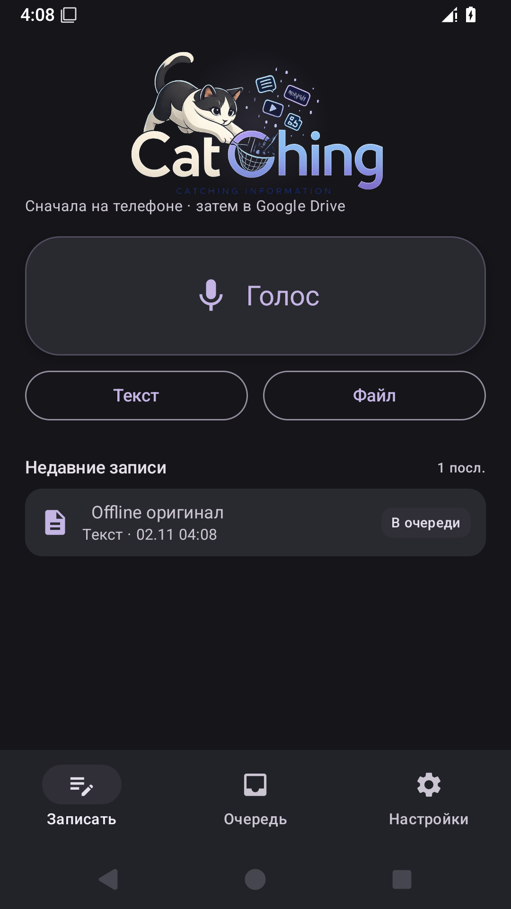
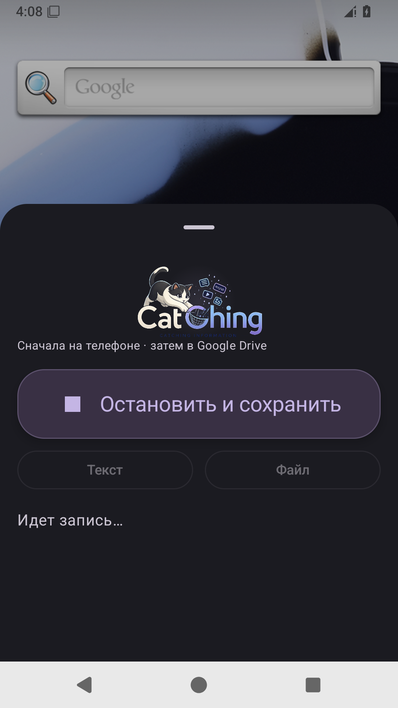
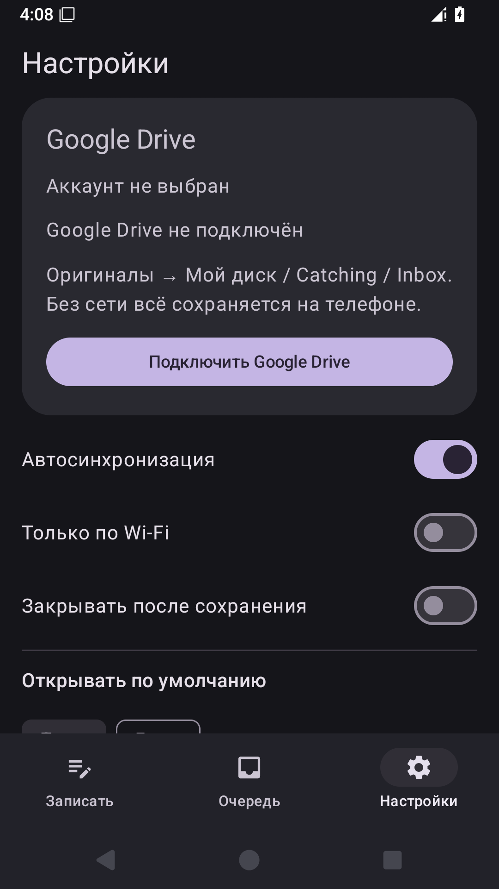

> Исторический отчёт 0.6.0. Его зелёный CI не доказывал миграцию исторической установки. См. [rework и проверенное исправление 0.6.1](issue-7-migration-rework.md).

# Catching: результат Issue #7

[PR #8](https://github.com/dedtsss/dispatcher-android-inbox/pull/8) реализует первый мобильный этап [канонического плана](https://github.com/dedtsss/agent-dispatch/blob/main/docs/memory/catching-agentic-inbox-2026-11-02.md). Исполняемый код проверен на коммите `87b95fe7a172d56702e48410febd7c7a2c601765`; последующий коммит с этим отчётом и снимками экрана не меняет приложение.

Catching сохраняет оригиналы локально, затем напрямую загружает их в видимый `Catching/Inbox`. Основной маршрут использует штатный Google `AuthorizationClient` и `drive.file`. Собственный API и debug-имитация отправки удалены. Локальные оригиналы автоматически не удаляются. Версия — **0.6.0 (6)**, package и постоянный сертификат сохранены.

## Доказательства

[Полный успешный CI](https://github.com/dedtsss/dispatcher-android-inbox/actions/runs/41385603930): unit-тесты, lint, подписанная release-сборка и Android 35 на GitHub runner. Тяжёлые Gradle/Android-сборки на VPS не выполнялись.

| Требование | Проверка и результат |
| --- | --- |
| Capture без интернета | Android-тест отключает Wi-Fi/мобильную сеть и проверяет отсутствие `activeNetwork`. Сохраняются текст через Compose, настоящий M4A из MediaRecorder и исходные байты вложения; статус остаётся `queued`. |
| Очередь и восстановление сети | WorkManager ждёт сеть. После её включения сам начинает обработку и сообщает о неподключённом Drive без потери оригиналов. Переключение ограничения Wi-Fi перепланирует уже ожидающую очередь. |
| Повтор после ошибки | Проверяется производственный `QueueDrainer`: временная ошибка даёт `error`, увеличивает счётчик, требует повтор; успех подтверждает `synced`. Файлы остаются на месте. |
| Drive destination | 8 unit-тестов проверяют видимые каталоги, исходный UTF-8, байты файла, папку связанного события, ошибки 401/403/429/503, потерю HTTP-ответа/TCP и отмену worker. |
| Отсутствие дублей | Drive ID сохраняется до создания объекта. Новый экземпляр destination после разрыва подтверждает тот же файл размером и MD5. Изменённый удалённый оригинал не перезаписывается. |
| Перезапуск процесса | После `am force-stop` отдельный инструментальный запуск находит одну контрольную запись в очереди, сохранённый Drive ID и проверяет SHA-256 всех локальных вложений. |
| Обновление Room | Реальная SQLite v1 мигрирует в Room v2; текст, путь, checksum, статус и счётчик повторов сохраняются. Destructive migration не используется. |
| Share и системный ассистент | На Android проверены `ACTION_SEND`, `ACTION_SEND_MULTIPLE` с двумя вложениями и голосовой `ACTION_ASSIST`; проверяются записи/источники в Room и локальные файлы. |
| Обновляемый release APK | Постоянные `DISPATCHER_SIGNING_*` Secrets; отсутствие ключа завершает CI ошибкой. `adb install -r` release поверх подписанной debug-сборки успешен; итоговый пакет не имеет `DEBUGGABLE`. |
| Интерфейс | Compose/Material 3, тёмный графит, мягкие скругления и сдержанный фиолетовый акцент; прежний фирменный кот без генерации новой графики, компактный assistant, раскрываемый текст и настройки Drive. Снимки ниже. |
| Реальный Android OAuth → Google Drive | **Не выполнен**, внешняя проверка описана ниже. Протокольные тесты Drive используют MockWebServer и не выдаются за реальную загрузку в Google. |

Итого: **14 unit-тестов и 3 Android-теста прошли**. `lintRelease`: **0 ошибок, 35 предупреждений** (обновления зависимостей/SDK и рекомендации по ресурсам). Полные XML/HTML-отчёты доступны в [артефакте проверок](https://github.com/dedtsss/dispatcher-android-inbox/actions/runs/41385603930/artifacts/13115601915), а `instrumentation.txt`, `restart.txt`, logcat, сведения установленного пакета и остальные снимки — в [артефакте Android](https://github.com/dedtsss/dispatcher-android-inbox/actions/runs/41385603930/artifacts/13115656958).

## APK

[Скачать подписанный APK с метаданными](https://github.com/dedtsss/dispatcher-android-inbox/actions/runs/41385603930/artifacts/13115586915) — файл `catching-0.6.0-release.apk` внутри архива. Срок хранения артефакта — **3 дня**, согласно действующему ручному маршруту проекта. Для повторной сборки используется `.github/workflows/android.yml` / `workflow_dispatch`; повтор проверки готовых APK без сборки допускает вход `apk_run_id`.

SHA-256 APK:

```text
ad71d7586c356d902f426847afb02002e132cfb0795f5b5fd5a3fc5c2a19a6bd
```

Скачанный APK дополнительно проверен локально через `apksigner`, `aapt`, `sha256sum -c SHA256SUMS`: package `ru.bruce.dispatcherinbox`, versionCode `6`, versionName `0.6.0`, подпись корректна. Тестовый ContentProvider присутствует только в закрытом debug-варианте и отсутствует в release.

## Внешняя проверка Google OAuth

Здесь нет подключённого устройства с аккаунтом владельца и доступа к конфигурации его Google Cloud. Поэтому реальное согласие пользователя и наличие тестового текста/файла в Drive **не подтверждены**. Наличие или отсутствие уже зарегистрированного клиента в Cloud также не утверждается.

Для регистрации либо проверки существующего **Android OAuth client** нужны точные параметры этого APK:

| Параметр | Значение |
| --- | --- |
| Package name | `ru.bruce.dispatcherinbox` |
| SHA-1 постоянного сертификата | `A6:C7:D7:85:0C:80:50:A4:B1:51:75:ED:34:A1:7B:7E:D8:80:98:11` |
| SHA-256 сертификата | `873bc4580e6d0387a37a155f5c6a6adba71d10408f53fd9d1e8834d54045a645` |
| Тип клиента | Android |
| API | Google Drive API, включённый в том же проекте |
| Scope | `https://www.googleapis.com/auth/drive.file` |
| Экран согласия | Настроен; при статусе Testing используемый аккаунт включён в тестовые пользователи |

SHA-1 взят из фактически подписанного APK и повторно сверен локально. Это прежняя signing identity проекта. Для штатной [Android-авторизации](https://developer.android.com/identity/authorization) не добавлялись web client secret, VPS-прокси или серверный обмен OAuth-кодом. После регистрации этого package/certificate тот же APK можно проверить без пересборки.

Окончательная проверка на устройстве владельца: установить APK поверх текущей версии, подключить Google Drive в настройках, сохранить тестовый текст и небольшой файл с известным SHA-256, дождаться `synced`, открыть `Мой диск / Catching / Inbox` и сверить исходное содержимое обоих объектов. Если возникает код 10, приложение прямо сообщает о необходимости настройки package/certificate.

## Снимки Android

Главный экран:



Компактная запись через системный ассистент:



Настройки Google Drive:



Агентный обработчик, ChatGPT, Obsidian, виджет и STT на телефоне не реализовывались. Ограничения фоновой работы Android и проверка роли/жеста assistant на целевой прошивке остаются особенностями устройства. Передача незавершённого файла повторяется с тем же Drive ID; сырые оригиналы не перезаписываются и автоматически не удаляются.
